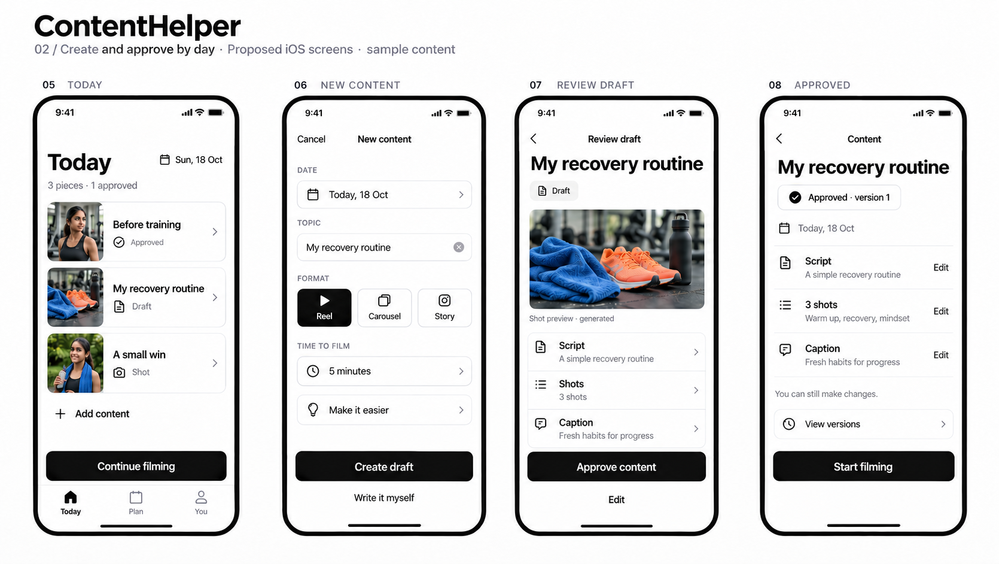
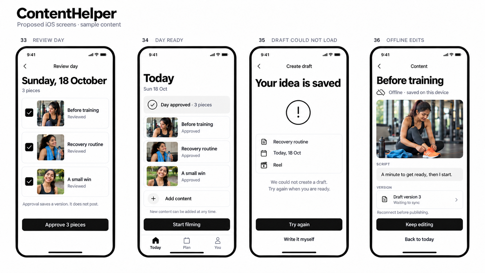
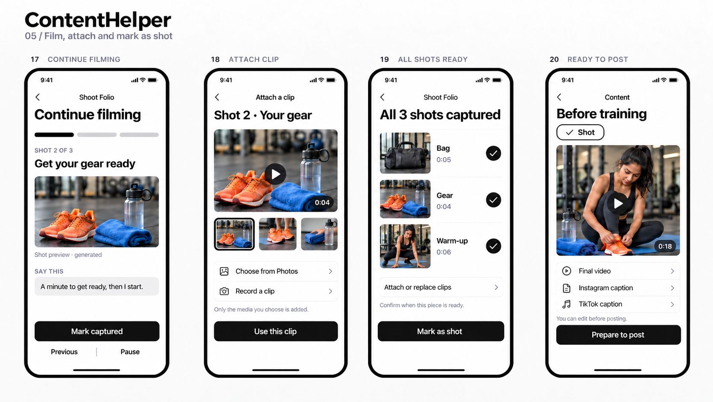
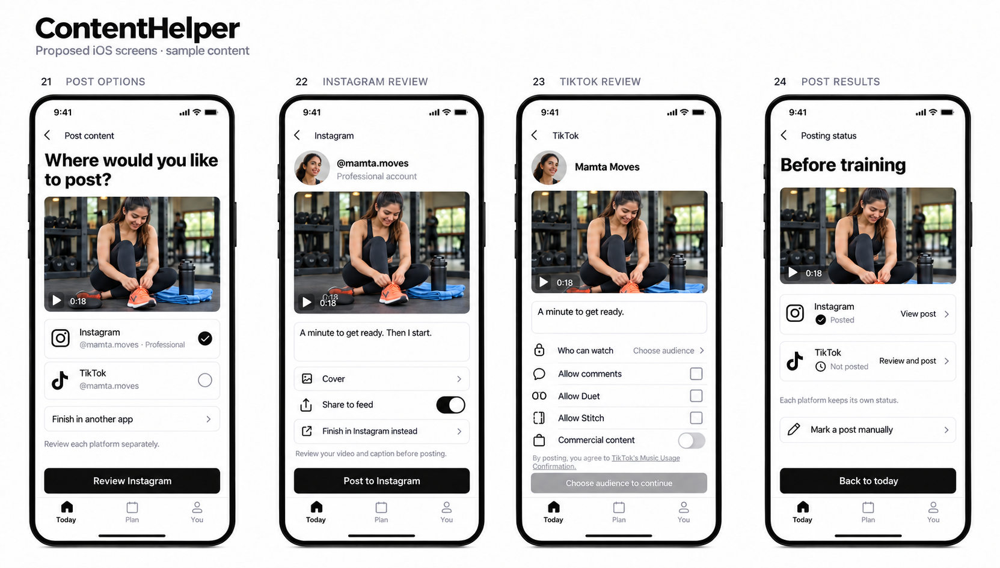
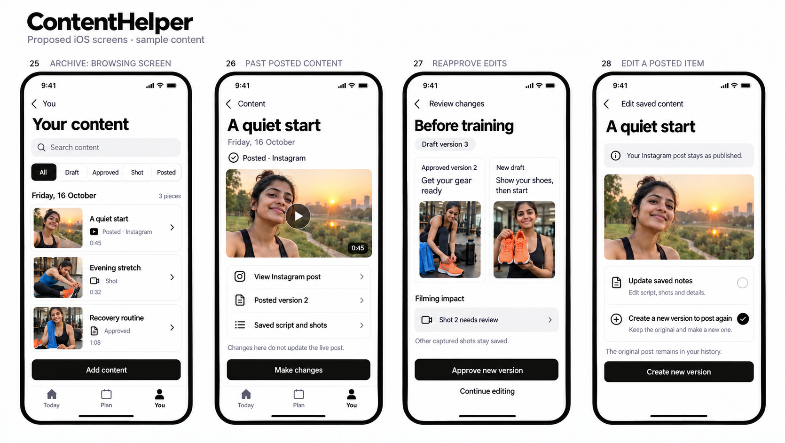

# ContentHelper: complete creator screen proposal

18 October 2026 · 40 screen concepts · 10 visual boards

Use [the review PDF](../../../output/pdf/contenthelper-creator-ios-screens-2026-10-18.pdf) for the complete set. Each page has four numbered screens. Individual images below can be marked up and revised separately.

The daily route is **Create → Review → Approve → Film → Mark as shot → Post → Revisit and edit**. A day can contain several pieces. Approval saves a version; it does not freeze the day or publish content. All app-owned controls are monochrome, while generated shot previews and uploaded media keep their color.

## Boards

| Board | Screens | Contents |
|---|---|---|
| [01 · First use](01-first-use.png) | 01–04 | Quick choices, AI choice, account, empty day |
| [02 · Daily creation](02-daily-create-approve.png) | 05–08 | Multiple pieces, new content, draft review, approval |
| [03 · Plan and dates](03-plan-review-dates.png) | 09–12 | Calendar, past day, saved detail, move date |
| [04 · Editing and versions](04-edit-and-versions.png) | 13–16 | Script, shots, platform captions, revision history |
| [05 · Filming](05-film-and-attach.png) | 17–20 | Resume shot, attach footage, mark shot, final media |
| [06 · Publishing](06-publish-platforms.png) | 21–24 | Target selection, Instagram, TikTok, separate results |
| [07 · Review past work](07-history-safe-edits.png) | 25–28 | Search, posted content, reapproval, new revision |
| [08 · You and accounts](08-you-and-connections.png) | 29–32 | Profile, connections, permissions, results |
| [09 · Day approval and recovery](09-day-review-and-recovery.png) | 33–36 | Approve day, ready day, retry, offline edits |
| [10 · Preferences](10-preferences-and-privacy.png) | 37–40 | Voice, reminders, AI/privacy, appearance |

## Daily creation

## Approve the day

## Film and prepare final media

## Review publishing destinations

## Change past work safely

## Supporting specifications

- [Screen index and routes](screen-index.md)
- [Daily flow, approval model and iOS layout contract](flow-and-state-spec.md)
- [Social integrations, current evidence and release conditions](platform-integrations.md)
- [Visual audit and proof limits](visual-audit.md)
- [Exact generation and refinement prompts](prompts/)

The [earlier reference audit](../../research/reference-visual-audit-2026-10-18.md) and [user-edited four-screen concept](../../research/visual-proposal-2026-10-18/contenthelper-creator-flow-concept-v3.png) supplied the starting direction. This proposal supersedes their one-piece-per-day rule and adds color within media surfaces. It preserves the requested removal of helper clutter.

These are raster design concepts with sample people, media and metrics. They are not editable native frames or a functioning prototype. API posting and insights depend on approved platform access. No app source, account connection or live post was changed.
