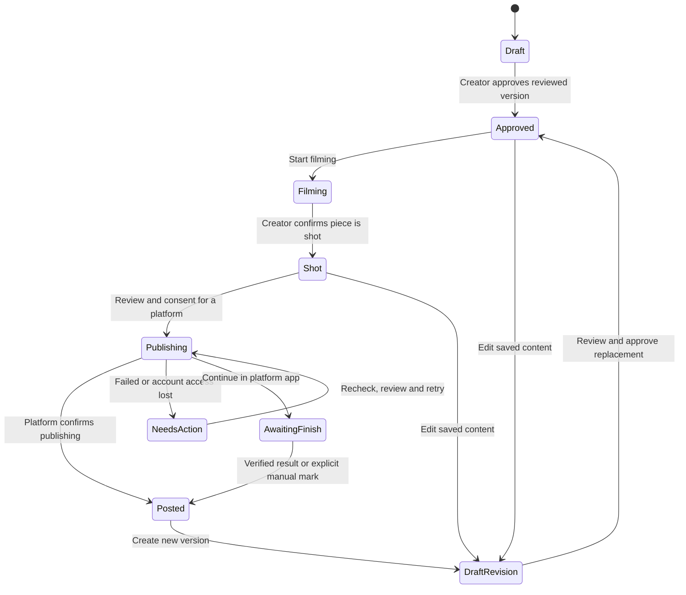

# ContentHelper: daily creation and approval

Design proposal, 18 October 2026. This extends the creator flow concepts and records the user's latest product decisions. These are screen designs and interaction contracts. They are not implemented app behavior.

## Decisions

- A date can contain several independent content pieces. This replaces the older one-package-per-date restriction in the research proposal.
- The creator can approve one piece or approve the reviewed pieces for a day. Approval does not publish content.
- Use **Approved**, rather than a lock icon or a promise that content cannot change. The creator can edit any saved piece later.
- Each piece keeps its script, ordered shots, generated shot previews, uploaded media, platform captions, revisions and publishing records together.
- App UI uses black, white and neutral gray. Generated shot previews and creator uploads keep their color. Color is not used for status, controls, charts, platform logos or decoration.
- Keep the three destinations **Today**, **Plan** and **You**. Account connections are optional and are introduced when useful.

## Main route

```mermaid
flowchart LR
    Launch[Open app] --> Setup[Quick choices or skip]
    Setup --> Consent[Choose AI use]
    Consent -->|Allow AI| Account[Sign in with Apple]
    Consent -->|Continue manually| Manual[Write a draft]
    Account --> Day[Today: several pieces]
    Manual --> Day
    Day --> Create[Add content for a date]
    Create --> Review[Review script, shots and caption]
    Review --> Approve[Approve piece or reviewed day items]
    Approve --> Film[Film and mark each shot captured]
    Film --> Shot[Mark piece as shot]
    Shot --> Post[Review each platform]
    Post --> Result[Posted, pending or needs action per platform]
    Result --> History[Return through Plan or Your content]
    History --> Revise[Edit notes or create a new revision]
    Revise --> Review
```

AI consent must cover each outbound AI task. A prior choice cannot authorize uploading newly attached private media for AI analysis. Declining AI keeps manual drafting and saved content available. Failed profile loading must not route an existing creator into a fresh setup.

The first-plan action retains the topic and language through consent and sign-in, then creates the requested draft and opens its review. It does not require the creator to press Create again on an empty home. Screen 04 is the alternate empty state after skipping setup or starting manually. Before production, the consent copy must name the actual AI provider and the data sent for each task.

## What each destination does

| Destination | Main job | Main actions |
|---|---|---|
| Today | Show the current day's pieces and the next useful action | Add content, review day, continue filming, prepare to post |
| Plan | Browse dates and revisit planned or past work | Select date, add piece, move a piece, open saved work |
| You | Manage identity, preferences and connections | Voice and topics, language, Your content, reminders, AI/privacy, appearance, accounts |

Today orders unfinished work by the creator's chosen order. It does not use a streak, urgency score or a red overdue state. Add content remains available after approval and after other pieces are posted. Long days scroll; primary actions do not cover the last row.

## Status belongs to a version and a destination

The familiar compact labels are **Draft → Approved → Shot → Posted**. Filming and publishing are progress details, not additional top-level navigation destinations. A posted piece can also have an unapproved newer draft. Show both facts: “Instagram posted · New draft to review”. Do not replace the posted record with a Draft badge.

### Daily approval

1. Review day lists each piece, its current revision and whether that revision was reviewed.
2. Opening a piece exposes its script, shots and caption. A changed revision invalidates its previous reviewed flag.
3. The creator can select reviewed drafts and use **Approve 2 pieces**, with the actual count. Unreviewed drafts have a visible Review action.
4. The day summary can say **Day approved · 2 pieces** when all included pieces have approved versions and no unapproved changes.
5. Adding or changing a piece changes the summary to **2 approved · 1 needs review**. Existing approvals remain saved.
6. Approval saves the reviewed revisions together. It does not start filming, upload media, post, or authorize later automatic publication.

### Editing rules

| Change | What happens |
|---|---|
| Edit an unapproved draft | Autosave local work, then sync; Save changes returns to review |
| Edit an approved piece | Create a draft revision; keep the approved version available until replacement is approved |
| Change script or shots after filming starts | Show which captured shots may need review; preserve media and unaffected progress |
| Reorder shots | Keep media attached to stable shot identities; do not bind clips by row index |
| Approve a changed shot | Ask the creator to review its captured state; do not silently delete footage or mark a new shot captured |
| Change a platform caption | Preserve other platform captions and completed post records |
| Edit posted content | Update local notes, or create a new version to post again; do not imply a live social post was changed |
| Restore an older version | Preview it, then create a new editable draft from it; keep later history |
| Move a piece to another date | Change its planned date; keep versions, media and progress; published timestamps remain factual |
| Duplicate a piece | Create a new draft with a new identity; do not copy Posted status or external post IDs |

### Filming and final media

Generated shot previews explain a planned shot; label them **Shot preview · generated**. They are never evidence that a shot was filmed. The creator can use their usual camera, then mark each shot captured. Attaching footage is useful but not required for manual progress tracking.

**Mark as shot** follows review of captured shots. It does not imply that separate clips were edited into a final video. **Prepare to post** requires a selected final asset for direct uploading. If there is no final asset, offer Attach final video, export the shot list, or continue in an editor. Selecting raw clips must not create a fake completed render.

Photo and carousel pieces use the same approval route but show “Prepare media” and “Mark ready” where filming language would be false. Story formats can use platform-app completion when direct publishing is unavailable.

### Publishing record

Each attempt stores the platform, account identity, reviewed content revision, final media identity, creator consent time, request identity, processing result, external post ID/link when available, and verification source. Implementation must keep credentials outside UI and logs.

| State | What the creator sees |
|---|---|
| Not posted | Review and post |
| Uploading | Transfer progress; leaving the screen preserves the attempt |
| Processing | “Processing on Instagram/TikTok”; no Posted claim yet |
| Sent for completion | “Finish in TikTok/Instagram”; still not marked posted |
| Posted and verified | Posted, platform/account, time, View post |
| Marked manually | “Marked posted by you”; optional post link; no API verification claim |
| Failed | Specific next action, retained media/caption and the other platform's result |
| Result unknown | Check status before retrying; do not send a duplicate blindly |

An item's overall Posted state is complete only for its selected target set. With one target posted and another outstanding, show “Instagram posted · TikTok not posted”. Removing an intended target requires an explicit edit to that plan and preserves its historical attempts.

## iOS layout contract

Applied skill: [ios-design-guidelines](/Users/prateekranka/.agents/skills/ios-design-guidelines/SKILL.md). Native tab navigation follows [Apple's tab-bar guidance](https://developer.apple.com/design/human-interface-guidelines/tab-bars); safe-area and adaptive layout rules follow [Apple's layout guidance](https://developer.apple.com/design/human-interface-guidelines/layout).

- Use large root titles, inline child titles, native back navigation and focused sheets for edits. Preserve the tab bar on browsing drill-downs; temporary full-screen task modals may cover it. Restore tab, selected date, filter, scroll and editor state.
- Body text uses the semantic Body style, normally 17 pt. Text must reflow at accessibility sizes. Minimum interactive area is 44 × 44 pt, including date arrows, inline Edit actions and media controls.
- Use 16 pt horizontal margins, an 8 pt spacing grid with 4 pt adjustments, 16 pt card corners and 14 pt control corners as starting tokens. Adapt to safe areas and content size.
- Primary actions share a footer position at the same text size/device size. Reserve space for tabs and optional secondary actions in every screen. At large text sizes, let the footer grow; never force a fixed image coordinate into production layout.
- Browsing and focused-modal footers share a common reserved tab-sized spacer when presented together on a concept board. Editors with a keyboard use a native Done control and a keyboard-safe action area.
- Palette: paper #FAFAFA, raised #FFFFFF, ink #111111, text secondary at least #666666 on white, hairline #E5E5E5 and soft fill #F0F0F0. Quiet gray is decorative only when it cannot meet text contrast.
- Dark mode uses neutral black/gray surfaces and white foreground actions. It must not desaturate photos or videos. Disabled controls remain gray and clearly labeled.
- Use monochrome words and icons for all states. Selection uses a checkmark, outline or fill. Errors use an icon plus text and a recovery action. Do not use colored warnings, platform brand fills, red destructive buttons or green switches in app-owned screens.
- VoiceOver reads piece title, date, status, revision state and action. Shot thumbnails have useful descriptions. Reordering has Move up/Move down alternatives. Reduce Motion removes decorative transitions.
- Generated previews and uploaded media are the only color-bearing surfaces. Native Photos, Apple sign-in and external social authorization screens are system/provider surfaces; the app cannot guarantee their appearance.

## Recovery and secondary states

| Situation | Required behavior |
|---|---|
| No pieces for date | Create draft and Write it myself; no empty score or streak |
| AI generation fails | Keep topic/date/format; Retry creates no duplicate item |
| AI declined | Manual draft, editing, review and progress remain usable |
| Offline | Show local-save and sync state; permit saved-content edits; block uploads until connection returns |
| Conflicting edits on another device | Keep both revisions; compare before replacement |
| Photo permission denied | Explain the requested media action; offer picker/settings/manual flow without repeated permission prompts |
| Upload stopped | Keep attempt status; recheck before offering a safe retry |
| Connection expired | Reconnect the named account; keep saved work and other connections |
| Wrong account | Change account before sending; show handle/nickname again in the final review |
| App interrupted | Return to the same date, piece, shot and upload attempt |
| Insights unavailable | State Not available or Permission needed; do not draw zero metrics |
| Archive/delete | Prefer recoverable archive; deletion confirmation names the exact item and retained external posts |

## Screen coverage

The visual boards contain 40 screen concepts. They show the main routes, daily approval, preferences and representative recovery states. Native authorization, system pickers, keyboard variants, all permission alerts, every metric type and every Dynamic Type size are specified behaviors rather than additional finished screens. Visuals are raster concepts, not editable native components or runtime proof.

Before implementation, build the shared day/item/version model and reusable footer, status, media and list components. Before any runtime-readiness claim, use the repository's TesterArmy e2e gate for the actual app. No runtime test or source implementation is part of this design delivery.
