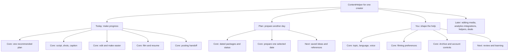
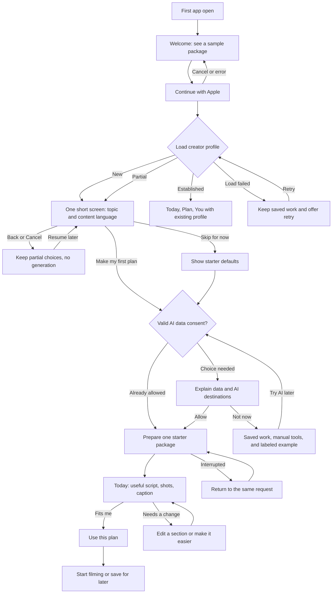
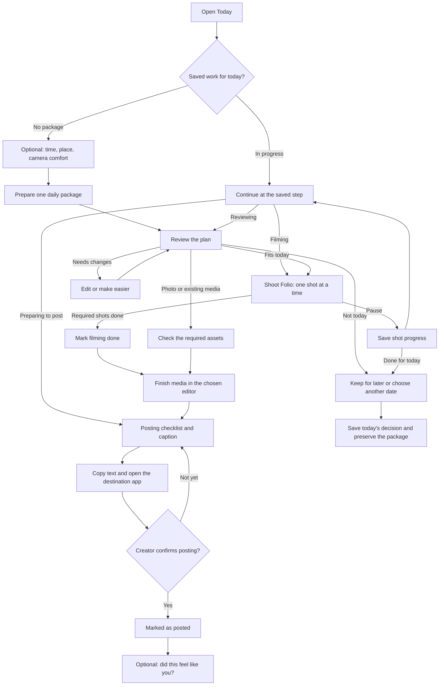
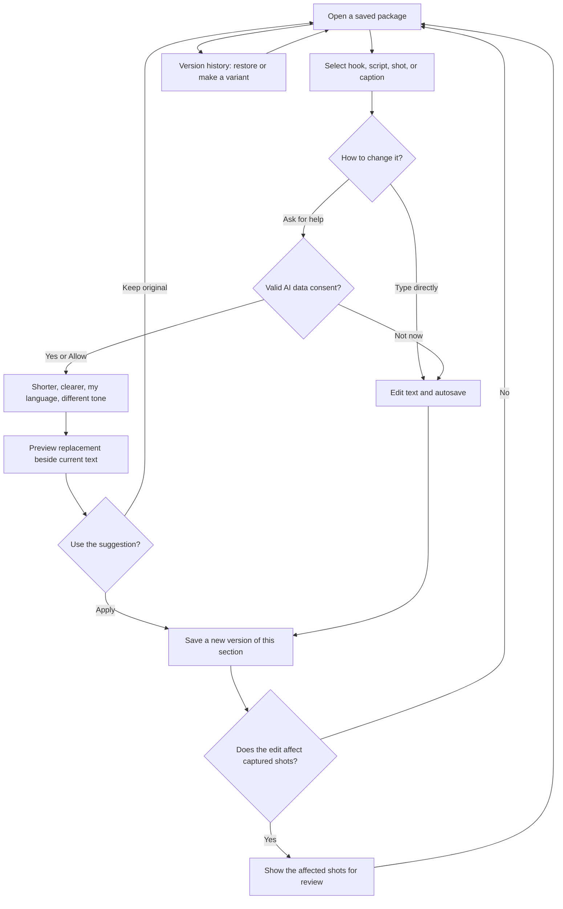
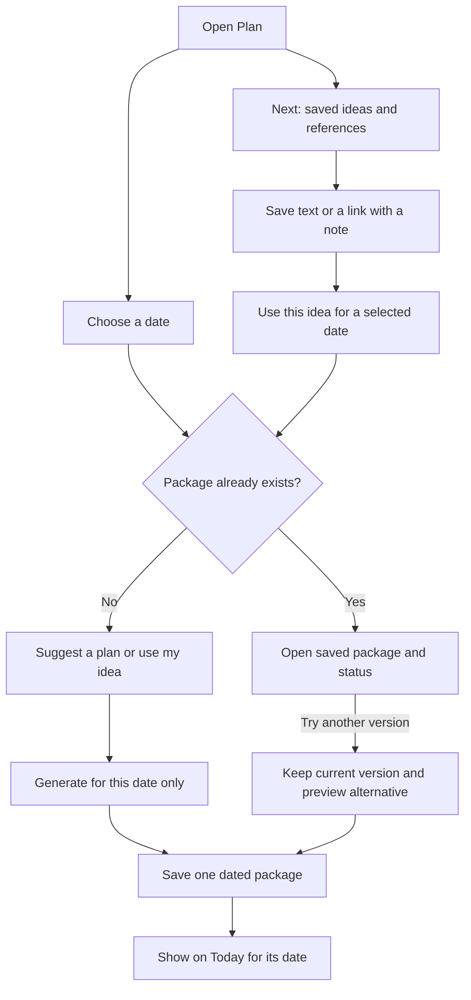
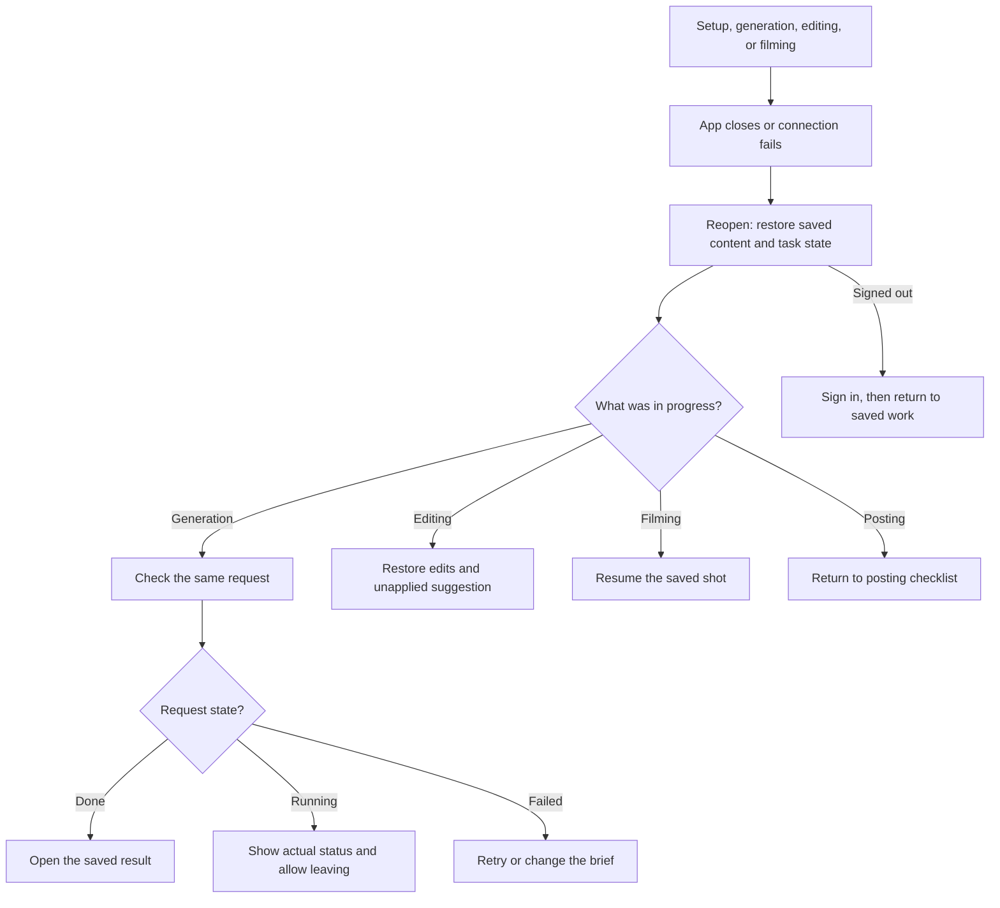

# ContentHelper: creator-first flows and feature maps

Research and proposal, 18 October 2026. Primary user: one creator working alone. This document proposes product behavior. It does not claim that these flows are implemented or tested.

Follow-up: [the visual reference audit](reference-visual-audit-2026-10-18.md) now adds actual screen observations, page captures, and access/version limits. The maps below remain proposals.

Editable Mermaid sources: [feature structure](creator-first-flow-maps-2026-10-18/01-feature-map.mmd), [onboarding](creator-first-flow-maps-2026-10-18/02-first-open-onboarding.mmd), [daily creation](creator-first-flow-maps-2026-10-18/03-daily-creation-and-completion.mmd), [editing](creator-first-flow-maps-2026-10-18/04-editing-and-versions.mmd), [planning](creator-first-flow-maps-2026-10-18/05-planning-and-inspiration.mmd), [recovery](creator-first-flow-maps-2026-10-18/06-interruption-and-recovery.mmd).

## Recommendation

Build the first experience around one outcome: **“I know what to make, and I can start.”** The next outcome is completing the content and preparing it for posting. These are separate milestones.

The product should carry the creator through a connected sequence:

**A little context → one useful plan → small edits → guided filming → posting handoff → a small lesson for next time.**

Keep Today / Plan / You. Make the content package the object that connects the journey: its brief, script, shot list, caption, versions, date, and completion state stay together. The creator should not need to move text between disconnected AI tools.

The supplied market research argues for personal creative direction for self-managed micro creators, with Mamta as the first fitness pilot. That supports early attention to language, identity, filming effort, and confidence. The market gap, willingness to pay, and effectiveness of AI creative direction remain hypotheses. [Supplied research](micro-creator-co-pilot-market-research-2026-10-17.pdf), [research interpretation](market-context-2026-10-17.md).

## What this keeps and what it proposes

| Area | Existing recorded direction | Recommendation in this proposal |
|---|---|---|
| Primary user | Older product documents include Creator and Manager | Use the creator-alone path first, as requested on 18 October. Keep helper access for later research. |
| Navigation | Today / Plan / You; Archive under You | Keep it. Each tab has a clear job. |
| Generation unit | One package for an explicit date; weekly batch generation retired | Keep one active package per date. Alternatives are versions, not silent extra daily packages. |
| Onboarding | Apple sign-in before generation; one short skippable choice screen | Keep this boundary. Use topic and content language as the useful early inputs. |
| AI data consent | Permission before outbound AI, including automatic ideas and thumbnails | Keep it. Explain the actual data and destinations before the first request. Not now keeps saved work and manual editing available. |
| First value | First useful script, storyboard, and caption package | Keep it. Distinguish a complete package from a sample or a generation event. |
| Creator voice | Optional detail belongs in You under the launch contract | Make voice refinement progressive. Remove any mandatory detailed voice gate if the current build still presents one. |
| Posting | External/manual; a local posted flag is bookkeeping | Keep manual handoff. Show “Marked as posted” after the creator confirms. |
| Payment | No trial/paywall in the current launch scope | Keep paid flows outside this proposal's first release. Research pricing separately. |
| New detail | Safe refinement, interruption, effort changes, and learning need an explicit flow | Propose the flows below. They require design and implementation review before delivery. |

Source decisions: [PRODUCT](../../PRODUCT.md), [accepted change ledger](../../change-ledger-accepted.md), [launch onboarding contract](../../onboarding-contract-launch-A.md), [privacy and account contract](../../privacy-account-contracts.md). Historical product instructions are context, not evidence of current runtime behavior.

## Map 1 — feature structure

Labels show recommended scope, not delivery status. “Core” means needed for the first complete creator journey. “Next” means add after that journey works with pilot users.

Today answers “What do I do next?” Its top card changes with the current task. A creator halfway through filming sees **Continue filming**, not another generation prompt. Plan answers “What have I prepared, and for which day?” You answers “What should this app know about me?”

Suggested Today card order: current action, package title, why it fits, estimated filming effort, then expandable script/shots/caption. Offer one clear primary action and secondary “Edit” and “Make it easier.” Avoid a feed of equal-weight choices.

## Map 2 — first open and onboarding

The welcome screen shows a clearly labeled example. Real personalization starts after sign-in. Only the short choices screen is setup; generation and reviewing the first plan are the first task.

| Screen | What the creator sees | Input and primary action | Exit and return behavior |
|---|---|---|---|
| O1 — Welcome | A concrete example: hook, three shots, caption; a short promise about knowing what to make | Continue with Apple | The example is labeled. It is not counted as the first useful personal package. |
| O2 — Native sign-in and profile routing | Apple authentication, then the current account's profile state | Sign in | Cancel returns to Welcome. New profiles reach choices; partial profiles resume choices; established profiles reach the shell. Profile-load failure preserves work and offers retry, without generation from an assumed empty profile. |
| O3 — Quick choices | “What do you make?” topic chips; “What language should your content use?” selector | Make my first plan; Skip for now | No required typing. Defaults are visible. A skipped profile produces a clearly described starter plan, with no invented personal history. Back/Cancel saves partial progress, does not generate, and does not mark setup complete. |
| O3a — AI data consent, only when needed | A short explanation of which data goes to the actual configured AI providers and why | Allow; Not now | Allow records the applicable consent. Not now blocks outbound AI and opens saved/manual work or the labeled example. Retry from the same feature later. |
| O4 — Preparing your plan | Truthful task state and a way to leave | Continue using the app | Save the request and restore it after exit. Avoid a made-up countdown or progress percentage. On failure, retry the same request or edit the brief. |
| O5 — First package on Today | One recommendation, why it fits the known inputs, effort estimate, script, shots, caption | Use this plan | Secondary actions: Edit, Make it easier, Another idea. Detailed voice setup is optional. |
| O6 — First useful action | First shot, or a saved package for a chosen date | Start filming; Save for later | Return to the saved package and its next action. |

For an established creator, open the relevant Today state even if there is no package for today. Do not replay onboarding or generate a first-plan replacement automatically. Use the existing profile. A partial profile resumes the same short choices screen. A profile-load failure opens the shell with retry and any safe saved work; it must not be treated as a new creator or overwrite the previous profile.

Content language is different from interface language. Keep the choice visible on the package. If a requested language is unsupported, explain this and offer supported choices. Do not infer the creator's language, age, or interests from location alone.

Ask about audience, goals, voice examples, filming locations, available time, and camera comfort when they affect the work. Keep them editable in You. After an edit, the app can ask “Use this style for future plans?” rather than silently treating every edit as a permanent preference.

The AI consent choice is required by the existing product contract. It is distinct from optional personalization. Check valid consent before every outbound path, including automatic Plan ideas, missing storyboard thumbnails, and refinements. Do not repeat the prompt while valid consent covers that use. A new user who declines can view the labeled example and use available manual tools; this is not counted as a personalized AI package. Name actual configured destinations rather than copying a provider list from an older design document.

This follows the pattern of preferences leading to a tailored result in [Spotify's Mobbin index](https://mobbin.com/explore/flows/d162ef83-02c1-45d9-be0f-6d03633ac095) and answers becoming a visible plan in [Busuu's Page Flows index](https://pageflows.com/post/ios/onboarding/busuu/). Apple recommends brief, optional onboarding, contextual teaching, and deferring nonessential setup. These are design references, not conversion evidence. [Apple onboarding guidance](https://developer.apple.com/design/human-interface-guidelines/onboarding?changes=_7).

## Map 3 — returning use through completion

The core Shoot Folio is a guide, not a promise of a built-in camera or video editor. Each shot shows what to capture, what to say, framing, and any required prop. “Captured” is the creator's confirmation. “Skip shot” must either be allowed by the plan or show which required element is still missing. Back and exit save progress.

For a photo or an existing-media post, bypass filming steps that do not apply. Do not force every format through a video checklist.

The posting checklist holds the caption, cover text, required media list, and any instructions for the destination app. In the core version, ContentHelper can share/copy its plan and text; the creator completes media editing and posting in their chosen apps. Do not label a plan export as a rendered-video export.

Support clear outcomes:

| Outcome | What it means | What it does not establish |
|---|---|---|
| Plan ready | A usable script, shots/storyboard, and caption are saved | Filming or publication |
| Filming done | The creator marked the required shots captured | A finished video |
| Ready to post | The creator completed the media and checked the package | Publication |
| Handed off | Text was copied or the destination was opened | Successful sharing |
| Marked as posted | The creator confirmed posting; optional URL/date saved | Independent platform verification |
| Not today | The creator made a decision; package and progress remain saved | Filming or posting completion |

Keep the “I posted it” action easy to reverse if selected by mistake. Archive preserves the package and its history. It is a location, not another production stage.

“Not today” is a valid daily outcome. Let the creator keep the plan for later or select a new date. Preserve the work, show no failure message, and use the occupied-date rules in Map 5 when moving it. Daily decision completion is separate from production progress and posting.

[Captions documents script preparation and scene-based recording](https://captions.ai/help/guides/creators/camera-teleprompter). [Buffer documents a preview, text copy, and native-app posting handoff](https://support.buffer.com/articles/using-notification-publishing-gvZQiMxVa2). The proposed ContentHelper flow joins these stages while keeping media editing external for the first release.

## Map 4 — making edits without losing work

“Make it easier” should use concrete constraints: less filming time, no talking to camera, fewer locations, or existing footage. Preview the resulting changes before applying them. A creator who says “Not me” can choose a reason such as topic, tone, experience, or too much effort. Offer a replacement while keeping the current plan available.

Editing rules:

- Target the selected part. Changing a caption should not silently regenerate the script and shots.
- Preserve a safe original for accepted work. A whole-plan alternative is explicit and has an undo path.
- Save direct edits as work progresses. For AI suggestions, require Apply before replacement.
- Changing the creator profile affects future suggestions by default. Updating a current plan is a separate action.
- If an edit changes the shot requirements, show the affected shots. Do not silently clear completed work.
- Deleting or replacing a package with manual edits needs a clear choice to keep, cancel, or replace it. Routine text editing does not need repeated confirmation.

These recommendations draw on [Buffer's Generate → adjust → Insert flow](https://support.buffer.com/en-us/articles/using-buffers-ai-assistant-qbBulfw9sn), [Adobe's selected-text refinement](https://helpx.adobe.com/express/mobile/publish-and-share/generate-captions-using-ai.html), and [Adobe's version recovery](https://helpx.adobe.com/express/web/arrange-layers-and-pages/version-history.html). They do not prove that competitor workflows preserve every dependency described here.

## Map 5 — planning another day and saving inspiration

Core planning is a dated list with status and a way to prepare one selected date. A week view may group these entries; it must not imply that the app generated a full week at once. Moving a plan to an occupied date needs an explicit resolution that preserves the other package.

The next release can add a small idea bank. Save a thought or reference without requiring a date or generating a package. A pasted URL may be stored even when the app cannot read the content. Show whether the source was actually read; offer a manual note when it was not. Ask for microphone permission only if optional voice capture is added and selected.

[Later separates saved ideas from creating a draft and preserves existing ideas when themes change](https://help.later.com/hc/en-us/articles/14711113026327-Generate-Content-Ideas-with-AI). [Edits places references and personal notes near the creation workflow](https://about.fb.com/news/2026/04/one-year-of-edits-built-for-and-with-creators/). These support the proposed idea-to-package transition. They do not require a large discovery feed in ContentHelper.

## Map 6 — interruption, failure, and return

| Condition | Required behavior |
|---|---|
| Generation fails or times out | Keep inputs. Check the existing request before starting another. Offer retry or change brief. Do not produce duplicate daily packages. |
| App closes while generating | Restore the request identifier and show its actual state. An accepted result becomes the saved package. |
| Profile cannot load after sign-in | Keep the shell and prior safe snapshot, offer retry, and block generation from guessed defaults. Do not show new-user setup to an established creator. |
| Creator cancels quick choices | Save partial choices. No generation, setup-complete flag, or profile deletion occurs. Resume the same choices later. |
| Connection drops while editing | Retain local edits and show save/sync status. Do not claim cross-device sync without confirmation. |
| Same package changes elsewhere | Preserve both edits or offer a clear conflict choice; do not silently overwrite. Cross-device editing can remain outside the first pilot. |
| App closes while filming | Keep checked shots and the current step. No inferred camera footage is needed to retain the checklist. |
| Creator returns from Instagram | Keep the package ready until the creator confirms posting. Opening Instagram is not confirmation. |
| Optional permission declined | Preserve the main workflow. Offer a manual path for references, reminders, or media selection. |
| AI consent declined or no longer valid | Block all outbound AI, including automatic work. Preserve saved packages and direct editing. Offer the consent choice again from the feature when the creator retries. |
| Creator asks to delete account/data | Explain the exact scope, obtain confirmation for deletion, and show the outcome. Keep this in You rather than onboarding. |

Draft recovery is a proposed requirement. The public library evidence does not establish these recovery guarantees.

## Learning without another setup task

After the creator uses a plan, ask one optional question: “Did this feel like you?” A negative answer opens a small set of reasons. Separate voice fit from filming difficulty.

After posting, the next release can let the creator attach a URL, record a short note, and enter a few available metrics. A review can suggest one experiment for the next plan and explain the evidence. Keep observation and inference separate: a post performing well does not prove that its hook caused the result.

Creator identity should be editable, with a clear distinction between what the creator entered and what the app suggests. The app should not invent life experiences, endorsements, results, or audience facts to make a script seem personal.

Trend help belongs inside a recommendation. Show the reference, freshness, reason for fit, and filming effort. If the app has no current source, avoid labeling a generic idea “trending.” Start with manually curated references in the pilot before building an extensive trend-monitoring system.

## Feature priorities

| Core: first complete journey | Next: test after the core works | Later: separate product bets |
|---|---|---|
| Short onboarding and editable defaults | Optional text/link/voice inspiration capture | Built-in camera and teleprompter |
| One useful dated recommendation | Saved idea bank and reference-to-plan flow | Automated media editing, captions, and B-roll |
| Script, shots/storyboard, caption | Editable audience, themes, and style examples | Connected account analytics |
| Direct edits, targeted AI edits, undo/history | Curated trend sources with freshness and fit | Automatic publishing and scheduling |
| Easier version for limited time or camera comfort | Optional reminders tied to a chosen task | Helper/manager accounts and collaboration |
| Guided filming checklist and pause/resume | Post URL, feedback, and simple experiments | Media kit, deals, deliverables, invoices |
| External editing and manual posting handoff | Better recommendations from approved preferences | Payment and subscription flows |
| Plan dates, Archive, save/recovery, AI consent, account controls | Measured tests of format and language support | Broad content discovery marketplace |

“Next” is not a requirement for the first useful package. Paid scope remains separate from the current launch decision.

## Example journey for the Mamta pilot

1. Mamta opens the app and sees an example of a short, practical content package.
2. She signs in, selects Fitness, and chooses her content language. She can skip the choices and revise them later. Before the first AI request, she reviews the data-use explanation and chooses whether to allow it.
3. Today presents one starter plan. A sample topic might be “My routine before training.” Personal details appear only after she supplies or confirms them.
4. She selects “No talking to camera” and “Less filming time.” The app previews a smaller shot list with on-screen text and an optional voiceover.
5. She edits a line to sound natural. The app offers to use the style for future plans, without forcing a voice questionnaire.
6. She completes two shots, leaves, and returns to the same filming step.
7. She finishes the media in her chosen editor, copies the caption, and posts in Instagram.
8. She returns and marks it posted. A one-tap check-in captures whether the plan felt like her and whether it was easy to make.

The flow should work without assuming that an older creator wants voice input, large tutorials, or a different interface. Test those preferences with Mamta directly.

Across these screens, support readable text sizes, adequate contrast, clear touch targets, screen-reader labels, and reduced motion. Show one primary action at a time. The filming guide must remain usable when text becomes larger; do not make a compact storyboard the only way to understand a shot.

## How to validate this proposal

Run an early usability study with 5–8 self-managed creators, including Mamta. Use tasks that do not tell participants which buttons to press:

| Task | What to observe |
|---|---|
| Open for the first time and find something you could make today | Time and uncertainty before a useful package; whether the creator can explain what to do next |
| Make the plan sound like you | Manual rewrite effort, use of targeted edits, understanding of Apply/Keep original |
| Make it work with less time and no talking to camera | Whether effort controls change the right parts without creating another setup burden |
| Stop halfway through filming and return later | Whether the saved next action is clear and the checked shots remain intact |
| Prepare content for another date that already has a plan | Whether the creator understands date, version, and replacement choices |
| Finish posting outside the app | Whether “Ready,” handoff, and “Marked as posted” are understood |

Track time to first useful package separately from time to first action, filming completion, posting confirmation, and repeat use. Count a generation event or sample view only as a system event, not proof of usefulness. Review the complete output and ask the creator whether it is usable. “Use this plan” and starting filming are stronger behavioral signals.

Use voice fit, edit burden, filming effort, recovery success, and repeat use to evaluate the first pilot. Set numeric targets after the baseline. Do not make short-term follower growth the only success measure.

These are proposed study tasks. No usability sessions or app behavior tests were run for this report. Any later automated app-flow verification must use the project's TesterArmy e2e gate.

## Research register and evidence limits

Checked 18 October 2026. Pattern libraries are references for sequences, not proof of product effectiveness. Official guides describe documented behavior; the apps were not run in this study. Some guides may differ by platform, plan, or app version.

| Source | Public evidence used | Design implication, proposed for ContentHelper |
|---|---|---|
| [Mobbin: Spotify onboarding](https://mobbin.com/explore/flows/d162ef83-02c1-45d9-be0f-6d03633ac095) | Flow description lists account creation, preferences, and a personalized home | Ask early only for choices that shape the first output |
| [Mobbin: Placify onboarding](https://mobbin.com/explore/flows/e7c01786-65e4-4739-903b-8bfbe339e7c6) | Description combines onboarding and creating a real place/photo | Teach through making the first useful object |
| [Page Flows: Busuu onboarding](https://pageflows.com/post/ios/onboarding/busuu/) | Indexed sequence includes language, experience, goal, study plan, and lesson. Follow-up browser inspection identifies this recording as January 2020 | Use as a historical pattern; let answers lead to visible work without copying the full sequence or payment steps |
| [Page Flows: Clubhouse](https://pageflows.com/post/ios/chat/clubhouses/) | Indexed setup can continue from Home | Keep optional profile completion available after first use |
| [Mobbin: Walmart Sparky AI](https://mobbin.com/explore/flows/0447ed53-fb99-4aff-9350-78944e8395fe) | Description includes AI suggestions and follow-up refinement | Offer concrete next edits alongside the output |
| [Mobbin: Saturn Calendar](https://mobbin.com/explore/flows/dab581d3-d756-4772-a3e1-46838624aecc) | Description includes voice/text input and confirmation | If voice capture is added, show the interpreted brief and a text alternative |
| [Page Flows: Bear creation](https://pageflows.com/post/ios/creating-a-post/bear-notes/) | Index includes note creation, drawing, and adding a link | Keep the draft central; reveal supporting tools where needed |
| [Apple: onboarding](https://developer.apple.com/design/human-interface-guidelines/onboarding?changes=_7) | Guidance favors brief, optional onboarding and contextual teaching | Defer detailed profile and permission requests until relevant |
| [Later: AI ideas](https://help.later.com/hc/en-us/articles/14711113026327-Generate-Content-Ideas-with-AI) | Brand context becomes themes/ideas; existing ideas survive theme changes; ideas become drafts | Profile changes should preserve accepted work |
| [Buffer: AI Assistant](https://support.buffer.com/en-us/articles/using-buffers-ai-assistant-qbBulfw9sn) | Generate, adjust wording/tone, then Insert | Preview AI suggestions before applying them |
| [Adobe Express: caption editing](https://helpx.adobe.com/express/mobile/publish-and-share/generate-captions-using-ai.html) | Can rewrite or resize selected text and insert output | Refine a section rather than replacing the package |
| [Adobe Express: version history](https://helpx.adobe.com/express/web/arrange-layers-and-pages/version-history.html) | Copy, bookmark, and restore versions | Provide explicit recovery and variant paths |
| [Captions: camera and teleprompter](https://captions.ai/help/guides/creators/camera-teleprompter) | Indexed official guide connects a prepared script, scene-based recording, retry, and export | Keep script and shot guidance together; a full in-app camera can come later |
| [Buffer: notification publishing](https://support.buffer.com/articles/using-notification-publishing-gvZQiMxVa2) | Preview, copy prepared text, open social app, finish there | Design the handoff as a complete task, with honest completion states |
| [Meta: Edits one-year update](https://about.fb.com/news/2026/04/one-year-of-edits-built-for-and-with-creators/) | Describes inspiration, saved references, notes, ideas, and feedback | Keep references connected to projects; add a small learning loop later |

The initial research pass used public descriptions and screen/step indexes. The [follow-up visual audit](reference-visual-audit-2026-10-18.md) now covers selected actual Mobbin previews and official Buffer, Adobe, and Captions interface images. Full Page Flows sequences remain gated, and Clubhouse/Bear remain text-index references. The Captions camera image was visually reviewed at the working official camera help page. Screenlane was not accessible and is not counted as a reviewed source. No accounts or subscriptions were created and no access controls were bypassed.

The maps and priorities are design judgments synthesized from these sources, the supplied PDF, and ContentHelper's recorded decisions. No source establishes that this proposed end-to-end experience has already been validated.
