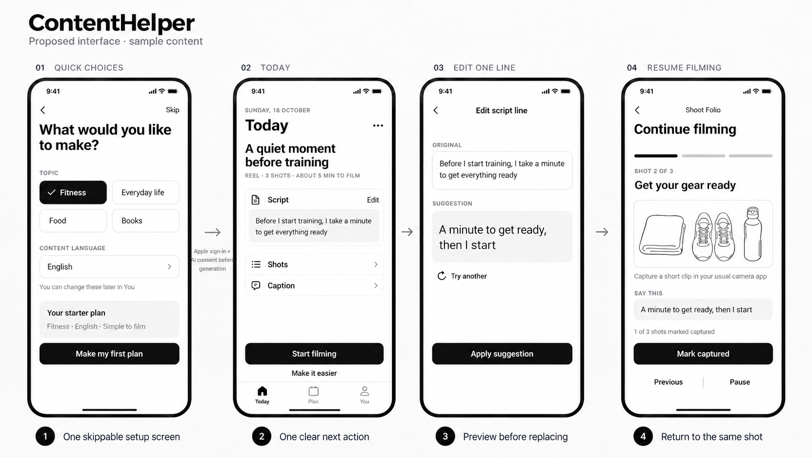

# ContentHelper visual proposal

Current revision: black primary buttons aligned across all four screens, retaining the earlier removals. [Alignment notes and exact edit prompt](v3-aligned-primary-buttons.md). [Previous removal notes](v2-yellow-marked-removals.md). [Marked reference](contenthelper-yellow-feedback.jpg). [Original board](contenthelper-creator-flow-concept.png).

Generated concept board with sample content: quick choices, Today, a focused script refinement, and resumed filming.

This is a raster concept, not a screenshot of the app or an editable native design. It does not establish accessibility or runtime behavior. App source and the existing Pen document were not changed.

The monochrome palette and spacing direction were taken from the current creator Pocket Sheet theme. Apple sign-in and AI consent occur before the first AI generation, as indicated between the first two screens. A full flow also includes the separate consent and generation states described in the flow proposal.

[Exact generation prompt](../contenthelper-visual-proposal-prompt-2026-10-18.md) · [Flow proposal](../creator-first-flows-2026-10-18.md) · [Reference visual audit](../reference-visual-audit-2026-10-18.md)

Created with the built-in imagegen tool on 18 October 2026.
