# Mira state machines

## How to change a state machine

1. Edit the Swift machine or the server transition code linked below.
2. Update the diagram and table here. Update the related [TLA+ model](../specs/tla/).
3. Run these checks from the repository root.

   ```sh
   python3 scripts/check-state-machine-doc.py
   python3 scripts/check-agent-rules.py
   python3 scripts/prove-agent-rules.py
   specs/tla/run.sh
   ```

The last column gives the primary next step for each state. Conditions can change the step the creator sees. A dash means the machine supplies no step. An event with no matching rule leaves the state alone.

The store keeps the current location, library, words, and request states.
The speech service and insights view each keep their own state. Send an event
through the existing transition path to change one of these fields. Reel
progress, Today cards, consent, and brief state are read from other records.

## `MiraReelProgress`

[Swift source](../CreatorContentOS/Mira/Core/StateMachines/MiraReelProgress.swift)

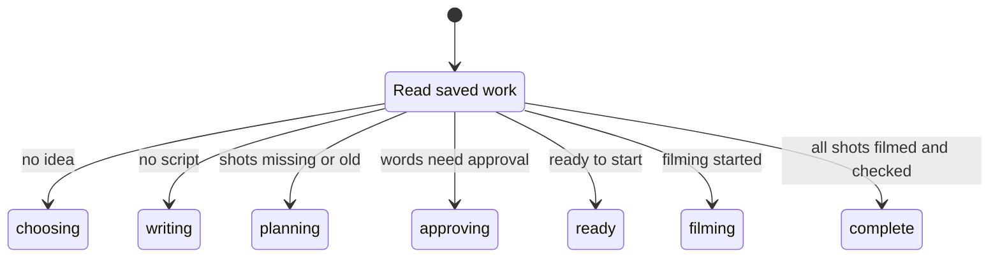

In every state, `workChanged` reads the project and follows the first matching rule in the diagram, from top to bottom. Edits and undo can return the Reel to an earlier state.

| State | Allowed event | Next state | Next step |
| --- | --- | --- | --- |
| `choosing` | Saved work changes | First match above | Choose an idea |
| `writing` | Saved work changes | First match above | Write your script |
| `planning` | Saved work changes | First match above | Make your shot list if missing. Update shot list if old. |
| `approving` | Saved work changes | First match above | Approve your words |
| `ready` | Saved work changes | First match above | Start filming |
| `filming` | Saved work changes | First match above | Continue filming |
| `complete` | Saved work changes | First match above | Review your filming plan |

## `MiraAIRequest`

[Swift source](../CreatorContentOS/Mira/Core/StateMachines/MiraAIRequest.swift)

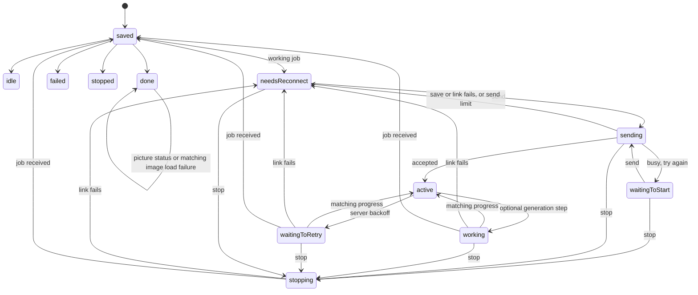

A saved job maps idle to `idle`, working to `needsReconnect`, failed to `failed`, cancelled to `stopped`, and succeeded to `done`. The store starts a fresh request with a new job. `Store read` in the table refers to the full saved-job mapping.

| State | Allowed events | Next state | Next step |
| --- | --- | --- | --- |
| `idle` | — | — | — |
| `waitingToStart` | Send again. Stop. | `sending`. `stopping`. | Stop |
| `sending` | Save fails or link fails. Server accepts. Server is busy. Stop. | `needsReconnect`. `working` with the job ID and optional step, or `waitingToRetry` during backoff. `waitingToStart`, or `needsReconnect` at the send limit. `stopping`. | Stop |
| `working` | Progress for the same job. Receive job. Link fails. Stop. | Replace the optional step in `working` or enter `waitingToRetry`. Store read. `needsReconnect`. `stopping`. | Stop |
| `waitingToRetry` | Progress for the same job. Receive job. Link fails. Stop. | `working` with the latest optional step, or `waitingToRetry` while backoff continues. Store read. `needsReconnect`. `stopping`. | Stop |
| `stopping` | Receive job. Link fails. | Store read. `needsReconnect`. | Wait |
| `needsReconnect` | Send again. Stop. | `sending`. `stopping`. | Reconnect |
| `failed` | — | — | Try again with a new job |
| `stopped` | — | — | Try again with a new job |
| `done` | Receive picture status. A picture fails to load from its current URL. | `done` with updated picture states by shot ID. A saved or newly completed job starts with an empty picture map. | — |

### Shot picture states

A successful text job can update its pictures independently. Each received picture list replaces the map. A shot missing from the list has no picture state and uses its drawn frame.

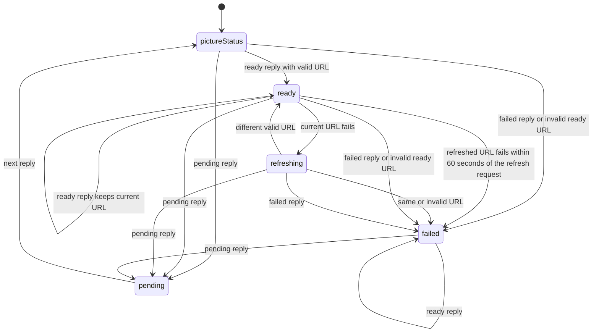

| Picture state | Allowed events | Next state | Preview |
| --- | --- | --- | --- |
| `pending` | Receive picture status | `pending`, `ready` with a valid URL, or `failed` | Drawn frame while the store checks status |
| `ready` | Receive picture status. Loading the current URL fails. | Keep the current URL on a valid ready reply. Use `pending` or `failed` when the reply requires it. On a load failure, enter `refreshing` unless the refresh was requested less than 60 seconds ago, in which case enter `failed`. | AI picture |
| `refreshing` | Receive picture status | `pending`, `ready` with a different valid URL, or `failed` | Drawn frame while the store requests fresh status |
| `failed` | Receive picture status | `pending` on a pending reply. Otherwise keep `failed`. | Drawn frame |

## `MiraTodayCardState`

[Swift source](../CreatorContentOS/Mira/Core/StateMachines/MiraTodayCardState.swift)

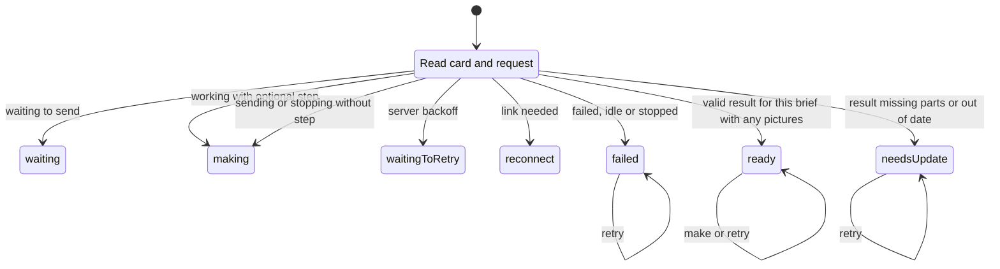

`workChanged` works from any state. A ready result has one idea, a script, and a shot list for the current brief. Picture status does not affect readiness. Make and Retry let the store act. The next projection reflects its changes.

| State | Allowed events | Next state | Next step |
| --- | --- | --- | --- |
| `waiting` | Card or request changes | Read card and request | Stop |
| `making` | Card or request changes | Read card and request. Keep prior output when available. Use the step from a working request. | Wait |
| `waitingToRetry` | Card or request changes | Read card and request | Stop |
| `reconnect` | Card or request changes | Read card and request | Reconnect |
| `failed` | Card or request changes. Retry. | Read card and request. `failed`. | Try again |
| `ready` | Card, request or picture state changes. Make or retry. | Read the current result and picture map. `ready`. | Make this one |
| `needsUpdate` | Card or request changes. Retry. | Read card and request. `needsUpdate`. | Update this idea |

### Today wait steps

The diagram shows how each server snapshot sets the wait screen for a card that is making its first result. A poll can skip steps. The card becomes ready after text success and validation.

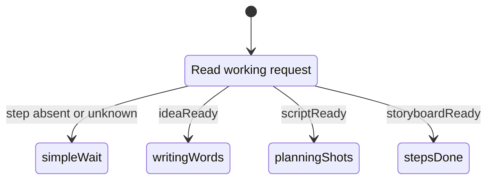

| Generation step | Server value | Wait screen |
| --- | --- | --- |
| No step | Absent or unknown | Simple wait screen |
| `ideaReady` | `idea_ready` | Finding an idea is complete. Writing your words is in progress. |
| `scriptReady` | `script_ready` | The idea and words are complete. Planning shots is in progress. |
| `storyboardReady` | `storyboard_ready` | All three steps are complete. Wait for text success. |

## `MiraWordsState`

[Swift source](../CreatorContentOS/Mira/Core/StateMachines/MiraWordsState.swift)

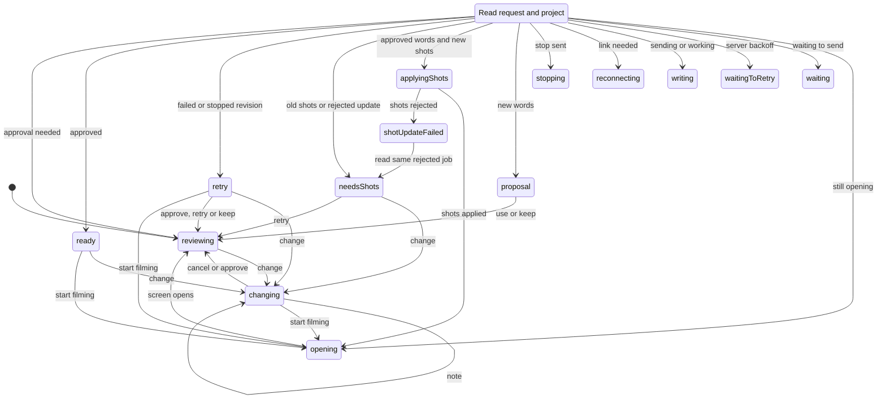

On every read, the current request can set the view state. The screen keeps an open edit if there is no active request or new proposal. `requestStarted` resets any state to `reviewing`. `appeared` keeps the state except when it clears `opening`. The table lists the other events. A send uses a nonempty note and keeps the state until the request starts.

| State | Allowed events | Next state | Next step |
| --- | --- | --- | --- |
| `reviewing` | Change. Send. Approve. | `changing`. `reviewing`. `reviewing`, then read project. | Approve your words |
| `changing` | Edit note or send. Cancel or approve. Start filming. | `changing`. `reviewing`. `opening`. | Send |
| `opening` | Screen opens | `reviewing` | Wait |
| `shotUpdateFailed` | Read the same rejected job | `needsShots` | Try again |
| `waiting` | Stop | `waiting`, then read request | Stop |
| `waitingToRetry` | Stop | `waitingToRetry`, then read request | Stop |
| `writing` | Stop | `writing`, then read request | Stop |
| `reconnecting` | Check again or stop | `reconnecting`, then read request | Check again |
| `stopping` | Read stop result | Read request and project | Wait |
| `proposal` | Use new words or keep current words | `reviewing` | Use this |
| `retry` | Change. Send. Approve, retry or keep. Start filming. | `changing`. `retry`. `reviewing`. `opening`. | Try again |
| `needsShots` | Change. Send. Retry. | `changing`. `needsShots`. `reviewing`. | Try again |
| `applyingShots` | Receive result. Apply shots. Reject shots. | `applyingShots`. `opening`. `shotUpdateFailed`. | Wait |
| `ready` | Change. Send. Start filming. | `changing`. `ready`. `opening`. | Start filming |

The store checks approval before it opens filming. If the check fails, it restores the prior words state.

## `MiraLocationState`

[Swift source](../CreatorContentOS/Mira/Core/StateMachines/MiraLocation.swift)

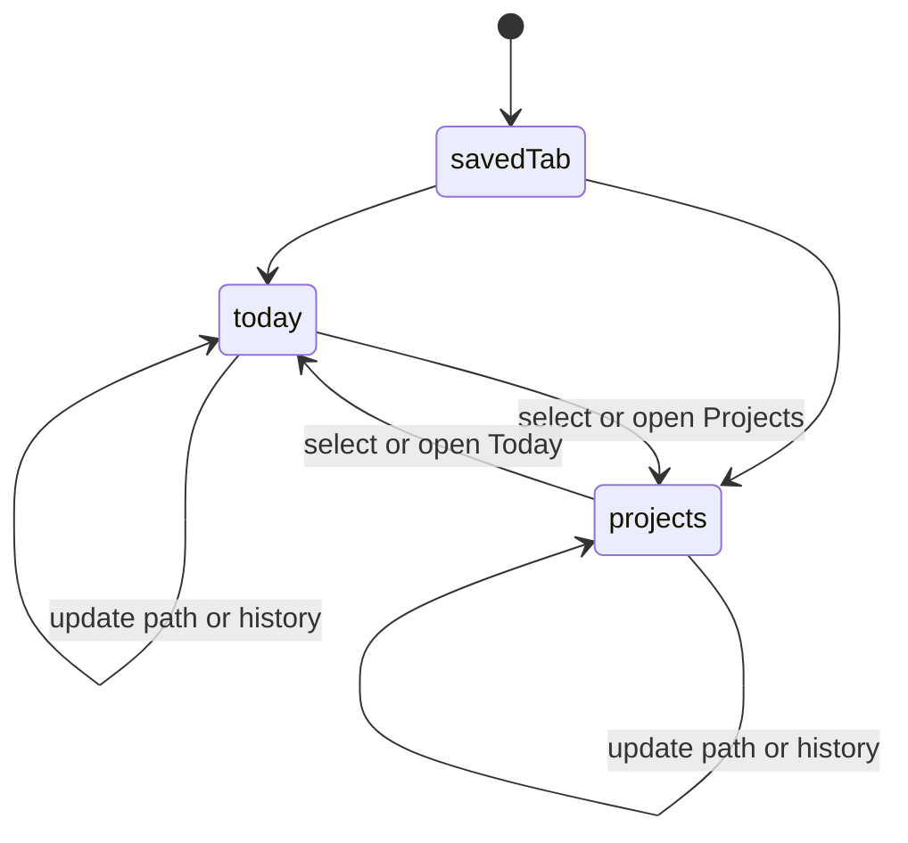

Either tab accepts `selectTab`, `open`, `setPath`, `push`, `showWords`, `remember`, and `remove`. The last five keep the active tab. `showWords` replaces the trailing filming or Done screens for that Reel. `remove` clears that Reel from both tab paths and its saved section.

| State | Allowed events | Next state | Next step |
| --- | --- | --- | --- |
| `today` | Select or open a tab. Update path or history. | Selected tab. `today`. | Use the current destination below |
| `projects` | Select or open a tab. Update path or history. | Selected tab. `projects`. | Use the current destination below |

### `MiraLocation`

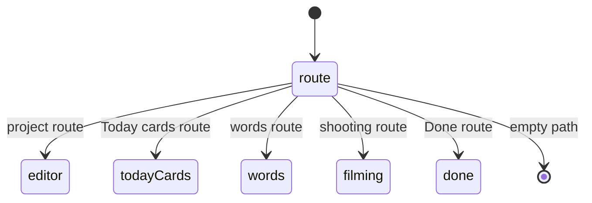

The last route on the active tab gives the current destination. Changing the path can select any destination in the table. An empty path has no current destination.

| State | Allowed event | Next state | Next step |
| --- | --- | --- | --- |
| `editor` | Change active path | Last route or no destination | Review your filming plan |
| `todayCards` | Change active path | Last route or no destination | Make this one |
| `words` | Change active path | Last route or no destination | Approve your words |
| `filming` | Change active path | Last route or no destination | Continue filming |
| `done` | Change active path | Last route or no destination | — |

## `MiraVoiceInputState`

[Swift source](../CreatorContentOS/Mira/Core/StateMachines/MiraVoiceInputState.swift)

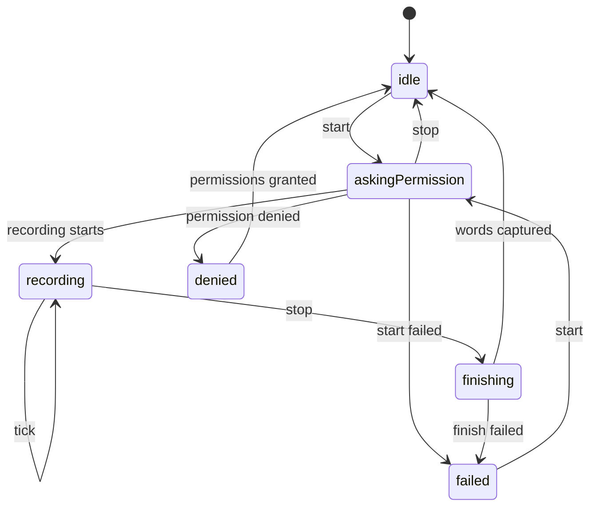

Replies and ticks must match the current attempt ID. Stop also runs when capture ends or reaches 60 seconds.

| State | Allowed events | Next state | Next step |
| --- | --- | --- | --- |
| `idle` | Start | `askingPermission` | Use microphone |
| `askingPermission` | Starts. Denied. Fails. Stop. | `recording`. `denied`. `failed`. `idle`. | Wait |
| `denied` | Both permissions granted | `idle` | Open Settings |
| `recording` | Tick. Stop. | `recording`. `finishing`. | Stop recording |
| `finishing` | Finish with words or an error | `idle` or `failed` | Wait |
| `failed` | Start | `askingPermission` | Use microphone |

## `MiraInsightsState`

[Swift source](../CreatorContentOS/Mira/Core/StateMachines/MiraInsightsState.swift)

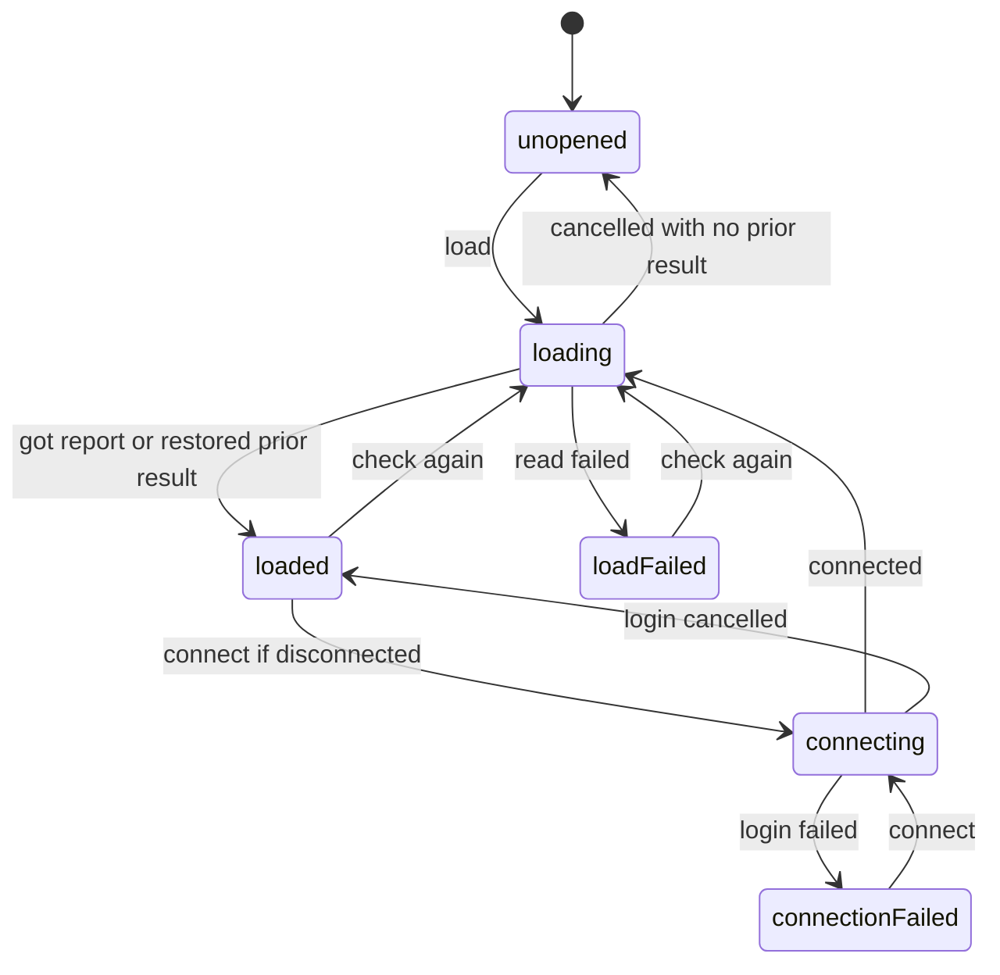

Each reply must match the current attempt ID. A failed refresh retains the previous result when one exists.

| State | Allowed events | Next state | Next step |
| --- | --- | --- | --- |
| `unopened` | Load | `loading` | Wait |
| `loading` | Read result. Read fails. Cancel. | `loaded`. `loadFailed`. `loaded` with prior result or `unopened`. | Wait |
| `connecting` | Connected. Login fails. Cancel. | `loading`. `connectionFailed`. `loaded` with disconnected result. | Wait |
| `loaded` | Load again. Connect if disconnected. | `loading`. `connecting`. | Connect Instagram if disconnected. Otherwise the machine selects Check again, and the screen shows the result. |
| `loadFailed` | Load again | `loading` | Check again |
| `connectionFailed` | Connect again | `connecting` | Connect Instagram |

## `MiraLibraryState`

[Swift source](../CreatorContentOS/Mira/Core/StateMachines/MiraLibraryState.swift)

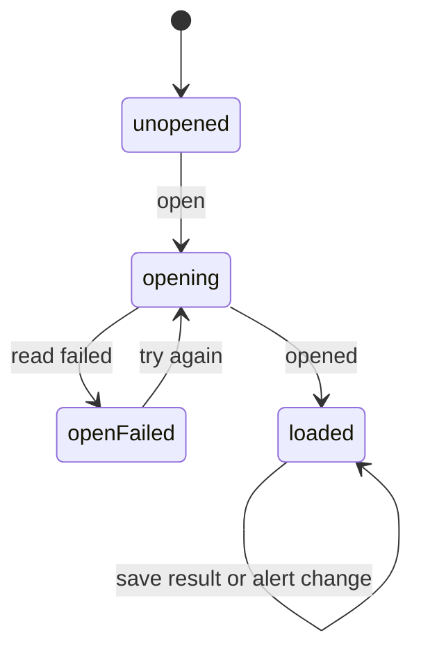

| State | Allowed events | Next state | Next step |
| --- | --- | --- | --- |
| `unopened` | Open | `opening` | Wait |
| `opening` | Opened. Open fails. | `loaded`. `openFailed`. | Wait |
| `openFailed` | Open again | `opening` | Update Mira for a newer save. Otherwise try opening saved work again. |
| `loaded` | Save succeeds or fails. Show or dismiss alert. | `loaded` | Continue |

## `MiraAIConsentState`

[Swift source](../CreatorContentOS/Mira/Core/StateMachines/MiraAIConsentState.swift)

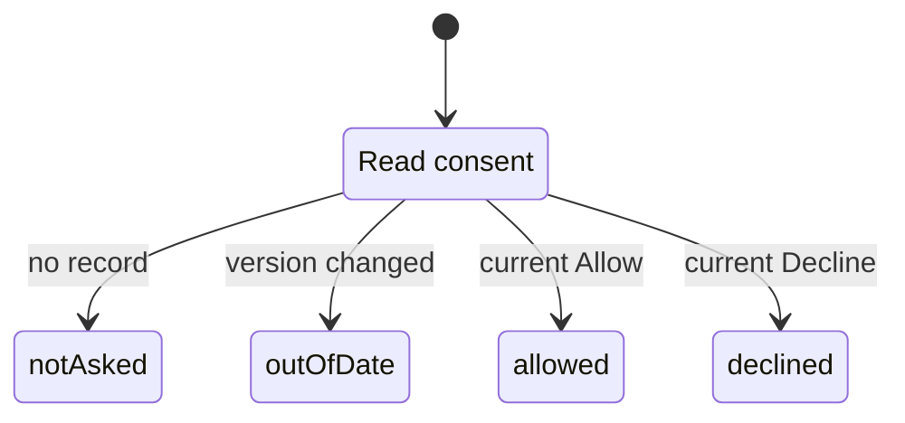

The machine reads the record from any state. Allow and Decline save a choice for the next read.

| State | Allowed event | Next state | Next step |
| --- | --- | --- | --- |
| `notAsked` | Read record | Match the record above | Review AI permission |
| `allowed` | Read record | Match the record above | Continue |
| `declined` | Read record | Match the record above | Review AI permission |
| `outOfDate` | Read record | Match the record above | Review AI permission |

## `MiraBriefState`

[Swift source](../CreatorContentOS/Mira/Core/StateMachines/MiraBriefState.swift)

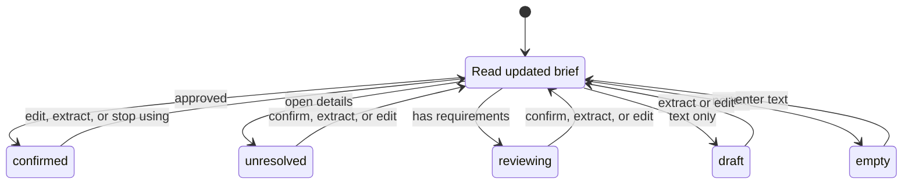

In any state, a changed text, a changed existing detail, removal, extraction, or Stop using clears approval. Confirm works if there is at least one requirement and all excerpts and values occur in the original text. Each accepted event adds one to the revision and reads the updated brief in the order shown.

| State | Allowed events | Next state | Next step |
| --- | --- | --- | --- |
| `empty` | Edit, remove, extract or stop using. Confirm if valid. | Read updated brief | Enter brand requirements |
| `draft` | Edit, remove, extract or stop using. Confirm if valid. | Read updated brief | Extract proposed requirements |
| `reviewing` | Edit, remove, extract or stop using. Confirm if valid. | Read updated brief | Confirm these requirements if valid. Otherwise extract proposed requirements. |
| `unresolved` | Edit, remove, extract or stop using. Confirm if valid. | Read updated brief | Confirm these requirements if valid. Otherwise extract proposed requirements. |
| `confirmed` | Edit, remove, extract or stop using. Confirm if valid. | Read updated brief | Edit brand requirements |

## Server text job

[Status schema](../supabase/migrations/20261026170000_mira_generation_jobs.sql) · [Current transition rules](../supabase/migrations/20261128030000_mira_phase_e_jobs.sql) · [Worker and API mapping](../supabase/functions/mira-generation/index.ts) · [Model](../specs/tla/MiraJobs.tla)

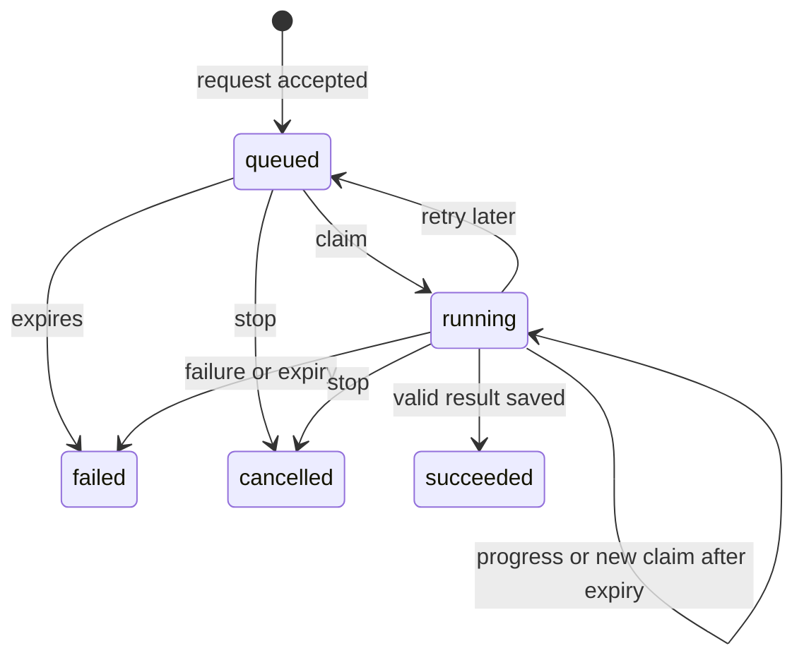

A lease gives a worker time to finish. A new claim needs a due job, fewer than three attempts, and a new lease. An unexpired claim can report progress in order from idea to script to shot list for `todayIdea` or `pickIdea`. A new claim resets progress. Daily Note gets one claim on the same UTC day and cannot return to the queue.

The API maps queued and running rows to working requests. It reports `waiting_to_retry` during backoff or after a claim expires with more attempts available. The Swift request and screen machines choose the visible next step.

| State | Allowed events | Next state | Next step |
| --- | --- | --- | --- |
| `queued` | Claim when due. Expire. Stop. | `running`. `failed`. `cancelled`. | Wait for the claim |
| `running` | Report progress. Claim again after lease expiry. Retry a temporary error. Save result. Fail or expire. Stop. | `running`. `running`. `queued`. `succeeded`. `failed`. `cancelled`. | Wait for the result or retry |
| `succeeded` | — | — | Open or review the result |
| `failed` | — | — | Try again if the screen offers it |
| `cancelled` | — | — | Try again if the screen offers it |

## Server picture job

[Status schema](../supabase/migrations/20261127200000_mira_steps_and_shot_pictures.sql) · [Current claim rules](../supabase/migrations/20261128030000_mira_phase_e_jobs.sql) · [Worker](../supabase/functions/mira-generation/shot-pictures.ts) · [Model](../specs/tla/MiraShotPictures.tla)

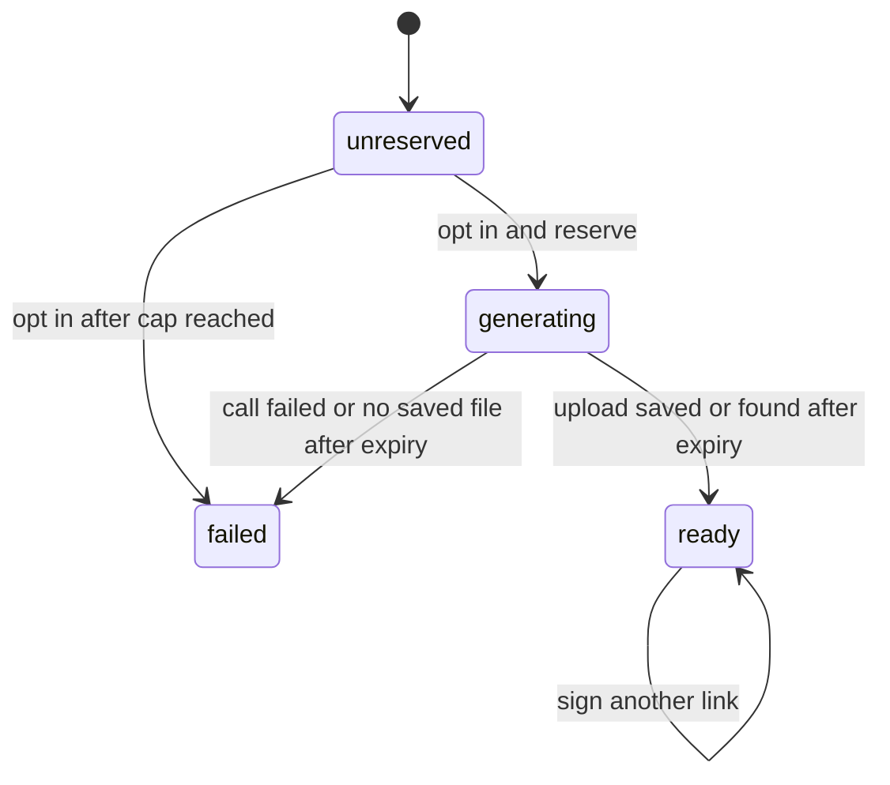

The first request for pictures on a completed, enabled card can reserve each shot once. A member can reserve up to 30 pictures per UTC day. Picture jobs use separate slots from text jobs. Text stays usable while pictures finish.

| State | Allowed events | Next state | Next step in the picture contract |
| --- | --- | --- | --- |
| `unreserved` (no row) | Request pictures on an eligible card | `generating` if a slot is free. Otherwise `failed`. | Use the shot plan |
| `generating` | Save upload. Call fails. Check expired claim. | `ready`. `failed`. `ready` if a saved file exists, else `failed`. | Use the drawing while the preview is pending |
| `ready` | Read or refresh link | `ready` | View the picture when the link is available |
| `failed` | — | — | Use the drawing |

The picture API returns `pending` during generation or when it cannot sign a ready picture's link. The table describes the API contract. The client must opt in to show the previews.

The shared TLA+ suite covers bounded S1 and D2 behavior. [Phase E evidence](mira-evidence/2026-11-28-phase-e-server.md) covers its additional limits and Daily Note rules.
